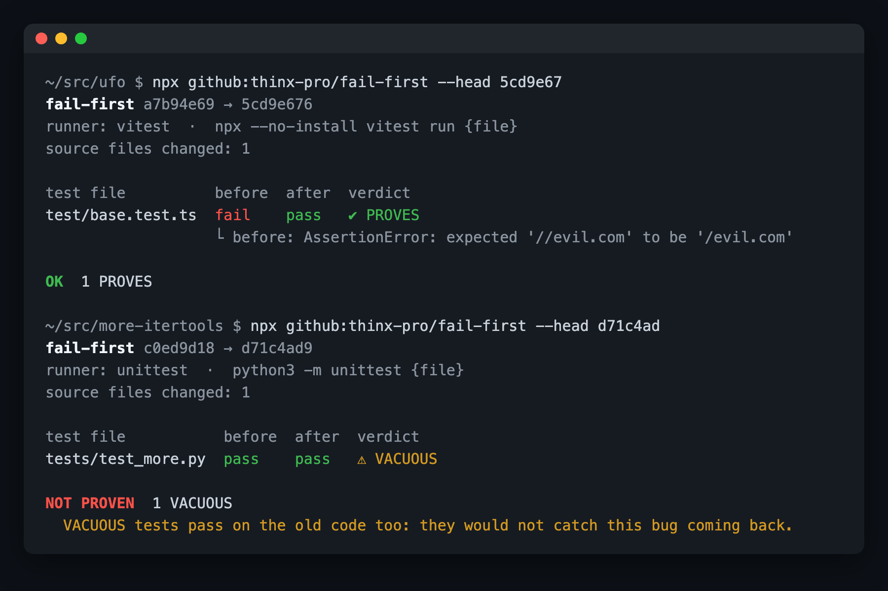

# fail-first

**Prove your new tests fail without your change.**

<!-- agent-preflight -->
> **Also a Claude Code skill.** `fail-first` is part of [agent-preflight](https://github.com/thinx-pro/agent-preflight), 16 offline checks for coding agents: `/plugin marketplace add thinx-pro/agent-preflight` then `/plugin install fail-first@agent-preflight`, and ask Claude in plain words.

   

fail-first runs the tests you added or changed twice: against the code **before** your change (they should fail) and **after** it (they should pass). A test that passes both times does not test your fix. It works with pytest, unittest, vitest, jest, mocha, ava, `node --test`, `go test`, cargo, rspec and minitest, or any command you give it.



*Real runs on public fix commits in [unjs/ufo](https://github.com/unjs/ufo) and [more-itertools](https://github.com/more-itertools/more-itertools). [All 23 commits →](examples/real-world.md)*

## Why

"Fixed, and added a regression test" is the most common sentence in a bug-fix PR, and the hardest to check in review. Did that test fail before the fix? Usually nobody runs it, so a test that would pass on the broken code too gets merged and the bug can come back unnoticed.

Benchmarks for coding agents already work this way. [SWE-bench](https://www.swebench.com/) scores a patch with `FAIL_TO_PASS` tests, which must fail on the original code and pass on the fixed code. fail-first applies the same check to your own changes, locally, in one command. It matters more now that coding agents write many of these tests and report "tests pass" as evidence.

## Quick start

```bash
cd your-repo                      # after fixing a bug and adding a test
npx -y github:thinx-pro/fail-first
```

That's it. With uncommitted changes it compares `HEAD` to your working tree. On a clean tree it checks the last commit (`HEAD~1 → HEAD`). For a whole branch:

```bash
npx -y github:thinx-pro/fail-first --base origin/main
```

## Verdicts

| verdict | before change | after change | meaning |
|---|---|---|---|
| ✔ `PROVES` | fail | pass | the test catches the bug |
| ⚠ `VACUOUS` | pass | pass | the test passes **without** your change: it does not test the fix |
| ✖ `BROKEN` | — | fail | the test fails with your change |
| · `TESTS_ONLY` | — | pass | only tests changed, so there is no "before" to fail against |
| · `EMPTY` | — | no tests | the runner collected nothing from this file |
| ✖ `NO_RUNNER` | — | — | the test command was not found |

For `PROVES` it also shows the line that made the old code fail, so you can see the test failed for the right reason (an assertion about the bug, not a typo or an import error).

Exit code `0` when every changed test proves the change (or there is nothing to check), `1` on any `VACUOUS`, `BROKEN` or `NO_RUNNER`, and `2` on usage errors. That makes it usable as a pre-push hook or a CI step.

## Options

```
--base <ref>        compare against this ref (uses the merge base), e.g. origin/main
--head <ref>        the "after" commit (default: HEAD, or the working tree if dirty)
--cmd "<command>"   test command; {file} = test file, {dir} = its folder
--tests <glob>      which changed files count as tests (repeatable)
--link <dir>        untracked dirs to borrow into the temp trees (default: node_modules, .venv, venv)
--timeout <sec>     per test run (default 300)
--json / --md       machine-readable output / Markdown table for PR comments
--keep / --verbose  keep the temp worktrees / print test output
```

Examples:

```bash
npx -y github:thinx-pro/fail-first --cmd "uv run pytest -q {file}"
npx -y github:thinx-pro/fail-first --cmd "go test -run . ./{dir}"
npx -y github:thinx-pro/fail-first --tests "src/**/*.check.ts" --cmd "npx tsx {file}"
npx -y github:thinx-pro/fail-first --base origin/main --md > fail-first.md   # paste into the PR
```

## Use it with a coding agent

Copy [`skill/fail-first/SKILL.md`](skill/fail-first/SKILL.md) to `~/.claude/skills/fail-first/SKILL.md` (Claude Code) or include it in your `AGENTS.md`. The skill tells the agent to run fail-first before it says a fix is done, and to strengthen a `VACUOUS` test instead of reporting it.

## How it works

1. Work out the range: `HEAD → working tree`, `HEAD~1 → HEAD`, or `merge-base(--base, --head) → --head`.
2. Split the changed files into **tests** (`test_*.py`, `*_test.py`, `*.test.ts`, `*.spec.js`, `__tests__/`, `*_test.go`, `*_spec.rb`, `*Test.java`, …), **test support** (`conftest.py`, `fixtures/`, `testdata/`, `__snapshots__/`, anything under `tests/`) and **source**.
3. **After:** run each changed test file on the new code (your working tree, or a temporary `git worktree` for a commit).
4. **Before:** create a temporary worktree at the old commit, copy in the *new* versions of the test and support files, and run them again. Only tests that passed in step 3 are re-run.
5. Compare and report. Temporary worktrees are removed at the end. Your working tree is never modified.

`node_modules`, `.venv` and `venv` are not tracked by git, so they are symlinked into the temporary worktrees from your repo.

## Tested on

- 18 automated tests (`npm test`): temporary git repos covering every verdict, dirty trees, untracked test files, feature branches with `--base`, modified test files, fixtures, Python unittest, custom commands, CLI exit codes and output formats.
- 23 real fix commits from more-itertools (unittest) and unjs/ufo (vitest): 20 `PROVES` and 6 `VACUOUS` across 26 test files. The 6 `VACUOUS` files come from 4 commits, each read by hand: two were expected (a refactor and a test clean-up), and in the other two the new test already passed on the unfixed code. Full table and reproduction steps: [examples/real-world.md](examples/real-world.md).

## Limitations and roadmap

- **File-level, not test-level.** If a file contains one new test that proves the fix and another that is vacuous, the file shows `PROVES`. Per-test results (pytest node ids, vitest `-t`) are next.
- A "before" failure caused by something other than the bug (for example the test imports a helper that the change added outside a test folder) still counts as `PROVES`. Read the reason line.
- Dependencies are taken from the current checkout. If the change also changes dependencies, the "before" run uses the new ones.
- Only root-level `node_modules` / virtualenvs are linked. Monorepos with per-package `node_modules` need `--link`.
- Tested live with unittest, vitest and `node --test`. pytest, jest, mocha, ava, go, cargo, rspec and minitest are detected but only covered by unit tests. Reports are welcome.
- Next: per-test granularity, a GitHub Action recipe, and a "mutation lite" mode that reverts one hunk at a time to show which part of the change each test depends on.

## License

MIT
